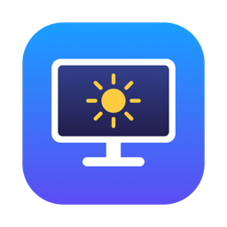

<p align="center">
  
</p>

<h1 align="center">Gestione Monitor</h1>

<p align="center">
  Regola il monitor esterno del Mac dalla barra dei menu, anche quando il monitor non accetta comandi DDC/CI.<br>
  Nativa, in un solo file Swift, senza dipendenze né driver.
</p>

---

## Cosa fa

| Regolazione | Come |
|---|---|
| Luminosità, contrasto, gamma | tabelle gamma del display (software) |
| Temperatura colore e guadagni R/G/B | tabelle gamma del display (software) |
| Risoluzione e frequenza, anche HiDPI | API CoreGraphics |
| Retroilluminazione, contrasto e volume hardware | DDC/CI via `IOAVService`, solo se il monitor lo supporta |
| Nome personalizzato del monitor | salvato nell'app |

- Le impostazioni vengono salvate per ogni monitor e riapplicate in automatico, anche dopo un cambio di risoluzione o un reset di ColorSync.
- **Avvio solo con un monitor esterno:** un LaunchAgent riapre l'app quando colleghi un monitor (evento IOKit `DCPAVServiceProxy` con `Location = External`). Senza monitor esterni l'app si chiude da sola dopo 5 secondi e ripristina i colori.
- Quando l'app si chiude, i colori tornano quelli di sistema.

## Requisiti

- Mac con Apple Silicon e macOS 14 o successivo
- Command Line Tools di Xcode (`xcode-select --install`). Xcode completo non serve.

## Installazione

```bash
git clone https://github.com/suonatorefelice/gestione-monitor.git
cd gestione-monitor
./install.sh
```

Compila l'app, la copia in `/Applications` e la avvia. L'icona compare nella barra dei menu. Per l'avvio automatico, attiva **"Avvia quando colleghi un monitor"** nel pannello.

Per compilare soltanto, senza installare, usa `./build.sh`.

## Struttura

```
Sources/GestioneMonitor.swift   l'app (SwiftUI MenuBarExtra)
Scripts/make-icon.swift         genera l'icona (AppIcon.icns)
Tools/ddc.swift                 CLI: ddc get/set <vcp>, ddc dim <5-100>
Tools/display-override/         esempio di override del nome di sistema
build.sh / install.sh
```

## Come funziona il DDC su Apple Silicon

Il metodo l'ho ricostruito analizzando MonitorControl con [REA](https://github.com/morluto/rea) (Hopper):

- il servizio si ottiene con `IOAVServiceCreateWithService` sul `DCPAVServiceProxy` con `Location = External`;
- i comandi DDC/CI partono con `IOAVServiceWriteI2C(service, 0x37, 0x51, …)`, la risposta si legge con `IOAVServiceReadI2C`;
- il checksum è lo XOR di `0x6E ^ 0x51` e dei byte del pacchetto; la risposta si verifica con `0x50`;
- la scrittura va ripetuta due volte a 10 ms di distanza, con 50 ms di attesa prima della lettura.

Se il monitor risponde sempre `6E 80 BE` (null message) a ogni richiesta, il canale I2C funziona ma il firmware del monitor ha il DDC/CI disattivato. È il caso delle schede controller generiche (per esempio Realtek RTD2555T "JG2555TC" per pannelli iMac 27" LM270WQ1). In quel caso restano le regolazioni software.

## Rinominare il monitor in tutto il sistema

Se l'EDID ha un nome generico (per esempio "HDMI"), macOS accetta un override:

```bash
sudo mkdir -p /Library/Displays/Contents/Resources/Overrides/DisplayVendorID-<vid-hex>
sudo cp Tools/display-override/DisplayProductID-6410.example \
  /Library/Displays/Contents/Resources/Overrides/DisplayVendorID-<vid-hex>/DisplayProductID-<pid-hex>
```

Nel file, modifica `DisplayProductName`, `DisplayVendorID` e `DisplayProductID` (in decimale). L'override si applica dopo un riavvio.

## Limiti

- Le regolazioni software agiscono sui colori, non sulla retroilluminazione: per consumare meno, abbassa la retroilluminazione dall'OSD del monitor.
- Non usarla insieme ad altre app che modificano il gamma (MonitorControl in modalità software, f.lux e simili).
- Nitidezza e saturazione si regolano solo via hardware (OSD o DDC).

## Licenza

MIT
